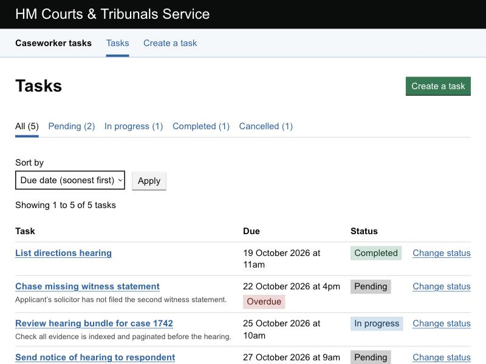
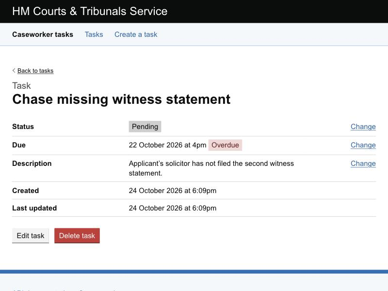
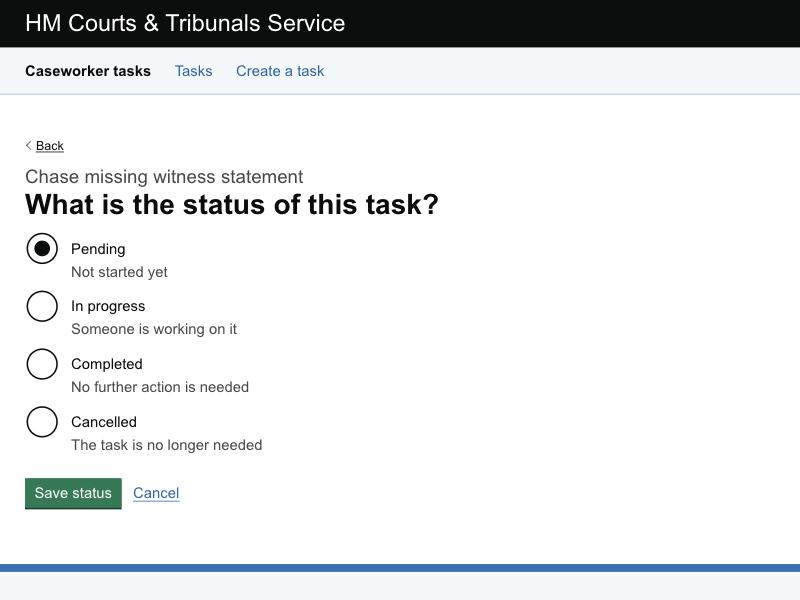
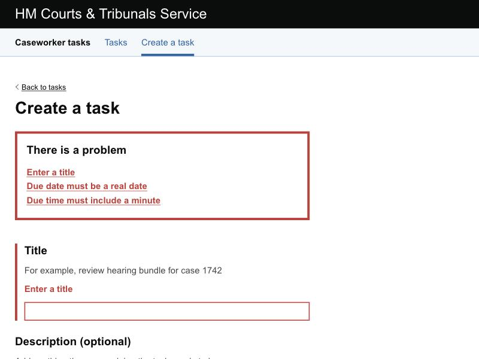
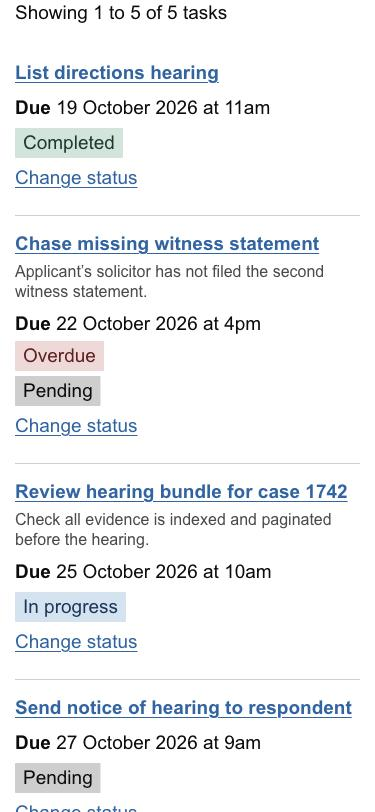
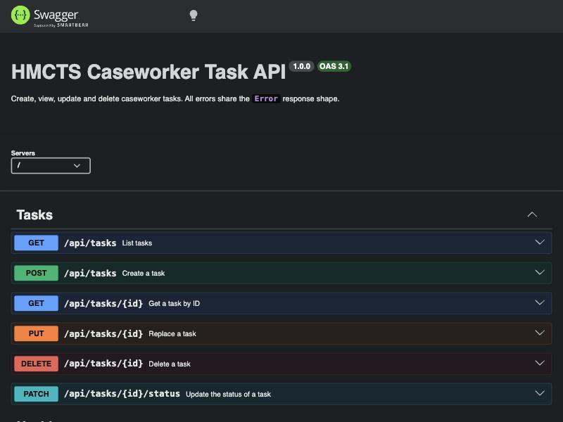

# HMCTS caseworker task manager

[](https://github.com/Trojan9/hmct/actions/workflows/ci.yml)

My submission for the [HMCTS DTS developer technical test](https://github.com/hmcts/dts-developer-challenge). Caseworkers can create, view, update and delete their tasks.

- **API**: TypeScript, Express 5, Prisma and PostgreSQL. Validation uses Zod. The endpoints are documented with OpenAPI 3.1 and Swagger UI.
- **Web app**: React and TypeScript, built with the [GOV.UK Design System](https://design-system.service.gov.uk/) and [MoJ Design System](https://design-patterns.service.justice.gov.uk/) components.



| Task page | Change status | Validation errors |
| --- | --- | --- |
|  |  |  |

| On a phone | API documentation |
| --- | --- |
|  |  |

## How the brief is met

| Requirement | Where |
| --- | --- |
| Create a task with title, optional description, status and due date/time | `POST /api/tasks`, the [Create a task](frontend/src/pages/TaskFormPages.tsx) page |
| Retrieve a task by ID | `GET /api/tasks/{id}`, the [task page](frontend/src/pages/TaskDetailPage.tsx) |
| Retrieve all tasks | `GET /api/tasks` (filter, sort, paginate), the [task list](frontend/src/pages/TaskListPage.tsx) |
| Update the status of a task | `PATCH /api/tasks/{id}/status`, the [change status](frontend/src/pages/ChangeStatusPage.tsx) page |
| Delete a task | `DELETE /api/tasks/{id}`, the [delete confirmation](frontend/src/pages/DeleteTaskPage.tsx) page |
| Unit tests | [backend/tests](backend/tests) and the `*.test.ts(x)` files in [frontend/src](frontend/src), run in [CI](.github/workflows/ci.yml) |
| Store data in a database | PostgreSQL through Prisma, see the [schema](backend/prisma/schema.prisma) and [migrations](backend/prisma/migrations) |
| Validation and error handling | Zod [schemas](backend/src/tasks/task.schemas.ts), a single [error handler](backend/src/middleware/errorHandler.ts), and GOV.UK [form validation](frontend/src/tasks/validation.ts) |
| Document API endpoints | Swagger UI at `/api-docs` and the raw spec at `/api-docs.json`, generated from [openapi.ts](backend/src/docs/openapi.ts) |

## Running it

You need Node.js 22 (see [.nvmrc](.nvmrc)). Docker is optional.

### Option 1: everything in Docker

```bash
docker compose up --build
```

- Web app: <http://localhost:8080>
- API documentation: <http://localhost:8080/api-docs>

This starts PostgreSQL, applies migrations, loads five example tasks and serves the web app through nginx. nginx also proxies the API, so the browser only talks to one origin.

### Option 2: no database (quickest)

The API can run against an in-memory store that is loaded with demo tasks. Data is lost when it stops.

```bash
cd backend && npm install && npm run dev:memory
```

```bash
cd frontend && npm install && npm run dev
```

Open <http://localhost:5173>. The Vite dev server proxies `/api` to the API on port 3001.

### Option 3: local development with PostgreSQL

```bash
docker compose up -d db
```

```bash
cd backend && cp .env.example .env && npm install && npm run db:migrate && npm run db:seed && npm run dev
```

Then start the frontend as in option 2.

## API

Full, interactive documentation is at `/api-docs`. Summary:

| Method | Path | Success | Errors |
| --- | --- | --- | --- |
| `GET` | `/api/tasks?status=&sortBy=&order=&page=&pageSize=` | `200` page of tasks and per-status counts | `400` |
| `POST` | `/api/tasks` | `201` task, with a `Location` header | `400` |
| `GET` | `/api/tasks/{id}` | `200` task | `404` |
| `PUT` | `/api/tasks/{id}` | `200` task | `400`, `404` |
| `PATCH` | `/api/tasks/{id}/status` | `200` task | `400`, `404` |
| `DELETE` | `/api/tasks/{id}` | `204` | `404` |
| `GET` | `/health`, `/health/ready` | `200` | `503` if the database is down |

Every error uses the same shape, so clients only need to handle one:

```json
{
  "error": {
    "status": 400,
    "code": "VALIDATION_ERROR",
    "message": "The request contains invalid data",
    "details": [{ "field": "title", "message": "Enter a title" }]
  }
}
```

Example requests:

```bash
curl -X POST http://localhost:8080/api/tasks -H 'Content-Type: application/json' -d '{"title":"Review hearing bundle","dueDate":"2030-01-31T09:30:00Z"}'
```

```bash
curl -X PATCH http://localhost:8080/api/tasks/<id>/status -H 'Content-Type: application/json' -d '{"status":"COMPLETED"}'
```

## Design decisions

### API

- **Layers.** Requests go through routes, then a controller (validates input, picks the status code), then a service (business rules), then a repository (persistence). The service depends on a `TaskRepository` interface, so its rules are unit tested with an in-memory repository and no database. The same repository powers the no-database mode.
- **A dedicated status endpoint.** The brief lists "update the status of a task" separately from editing, so it has its own `PATCH /api/tasks/{id}/status` that only accepts `status`. `PUT` replaces all editable fields.
- **Strict validation.** Unknown fields are rejected rather than ignored. `sortBy` and `status` are allow-listed. This also stops arbitrary query values reaching the ORM. Blank descriptions are stored as `null`, so "no description" has one meaning.
- **Due dates.** A new task must be due in the future. An existing task can keep a past due date, so an overdue task can still be edited. The rule is checked in the service using an injectable clock, so it can be tested. Dates are stored as `timestamptz` and exchanged as ISO 8601 with an offset.
- **Listing.** Results are paginated (default 20, maximum 100) and sorted with a tie-breaker on `id`, so pages are stable. The response includes counts for every status, so the UI can show filter counts without extra requests. There are indexes on `status` and `due_date`.
- **Errors.** Known errors (`AppError`) keep their status and message. Malformed JSON gets a `400` and oversized bodies get a `413`. Anything unexpected is logged with its request ID and returned as a generic `500` that never leaks internals.
- **Operational basics.**
  - Configuration is validated on start-up.
  - Structured JSON logs (pino) with an `X-Request-Id` header on every response.
  - Helmet security headers, CORS limited to configured origins, and rate limiting on `/api`.
  - Liveness and readiness checks, and graceful shutdown.

### Web app

- **GOV.UK Design System without GOV.UK branding.** It uses GOV.UK and MoJ Frontend components and patterns that HMCTS services use. Because this internal tool is not on a gov.uk domain, it follows the guidance on [using GOV.UK Frontend without GOV.UK branding](https://frontend.design-system.service.gov.uk/using-govuk-frontend-without-govuk-branding/). That means the [generic header](https://design-system.service.gov.uk/components/generic-header/), Arial instead of GDS Transport, and no crown. Only the components in use are compiled into the stylesheet.
- **GOV.UK patterns.**
  - [Validation](https://design-system.service.gov.uk/patterns/validation/): validates on submit, then shows an error summary that takes focus, inline errors linked by `aria-describedby`, and an `Error:` prefix in the page title.
  - [Date input](https://design-system.service.gov.uk/components/date-input/) with its recommended error messages.
  - [Character count](https://design-system.service.gov.uk/components/character-count/), [summary list](https://design-system.service.gov.uk/components/summary-list/) with change links, and [one question per page](https://www.gov.uk/service-manual/design/form-structure) for changing status.
  - A confirmation page with a [warning button](https://design-system.service.gov.uk/components/button/#warning-buttons) for deleting, instead of `confirm()`.
  - [Notification banners](https://design-system.service.gov.uk/components/notification-banner/) for confirmations, and [page not found](https://design-system.service.gov.uk/patterns/page-not-found-pages/) and [problem with the service](https://design-system.service.gov.uk/patterns/problem-with-the-service-pages/) pages.
  - [MoJ sub navigation](https://design-patterns.service.justice.gov.uk/components/sub-navigation/) for status filters.
- **State in the URL.** Filter, sort and page are query parameters, so a view can be bookmarked or shared, and the back button works. Sorting uses an Apply button rather than auto-submitting, as GOV.UK recommends.
- **Accessibility.**
  - Skip link and landmarks; visually hidden text gives context to repeated links (for example "Change status *of Chase witness statement*").
  - Focus moves to the new page's heading after each navigation, since a single-page app doesn't do this by itself.
  - The table becomes stacked blocks on small screens.
  - Every page was checked with axe-core in a real browser, and automated axe checks run in the test suite. No WCAG 2.2 AA issues were found. It has not been tested with real assistive-technology users.
- **Security in production.** nginx serves the app with a strict Content Security Policy (no inline scripts or styles) and other security headers.

## Testing

| Suite | What it covers | Command |
| --- | --- | --- |
| API unit | Service rules with a fixed clock, Zod schemas, config, errors | `cd backend && npm test` |
| API integration | Every endpoint through the real Express app (supertest): validation, 404s, bad JSON, body limits, rate limiting, CORS, request IDs, health checks | `cd backend && npm test` |
| API database | The Prisma repository against real PostgreSQL: sorting, paging, counts, not-found handling | `cd backend && npm run test:db` (needs `DATABASE_URL`) |
| Web unit | Form validation, date formatting and due states, pagination, API client | `cd frontend && npm test` |
| Web pages | The whole app against a stateful fake API: every journey, error states, focus management, page titles, plus axe accessibility checks | `cd frontend && npm test` |
| Smoke | `docker compose up`, then create, update and delete a task through nginx | CI only |

Coverage thresholds are enforced (`npm run test:coverage`). [CI](.github/workflows/ci.yml) runs the following on every push and pull request:

- Linting, Prettier and type checks.
- All test suites, with migrations applied to a PostgreSQL service.
- A check that the Prisma schema matches the migrations.
- `npm audit` of production dependencies, CodeQL and the Docker smoke test.

Dependabot keeps dependencies up to date.

## Project structure

```
backend/
  prisma/              schema and migrations
  src/
    app.ts             builds the Express app from its dependencies
    server.ts          starts it (PostgreSQL or in-memory store)
    config/            validated environment configuration
    docs/              OpenAPI document
    errors/            AppError, ValidationError, NotFoundError
    middleware/        error and 404 handlers
    tasks/             routes, controller, service, schemas, repositories
  tests/               unit, integration and db suites
frontend/
  src/
    api/               typed API client
    components/        layout and GOV.UK components (error summary, pagination, ...)
    pages/             one file per page
    tasks/             validation, dates, status labels, React Query hooks
    test/              fake API and render helpers
  nginx/               production server config
docker-compose.yml
```

## How this was built

The original submission was a single commit. I then improved it through separate branches, one per change. Each was opened as a pull request into `main` and merged with a merge commit, so the history shows what changed in each step and why:

| PR | Branch | Change |
| --- | --- | --- |
| [#2](https://github.com/Trojan9/hmct/pull/2) | `chore/repo-cleanup` | Stop tracking logs, the local database and `.env`; add `.gitignore` and editor config |
| [#3](https://github.com/Trojan9/hmct/pull/3) | `feature/api-refactor` | Layered API, PostgreSQL, status endpoint, validation, error handling, OpenAPI docs |
| [#4](https://github.com/Trojan9/hmct/pull/4) | `test/api` | API unit, integration and PostgreSQL tests |
| [#5](https://github.com/Trojan9/hmct/pull/5) | `feature/api-docker` | API Dockerfile and the no-database demo mode |
| [#6](https://github.com/Trojan9/hmct/pull/6) | `feature/govuk-frontend` | Frontend rebuilt with the GOV.UK Design System |
| [#7](https://github.com/Trojan9/hmct/pull/7) | `test/web` | Frontend unit, page and accessibility tests |
| [#8](https://github.com/Trojan9/hmct/pull/8) | `feature/docker-compose` | Web Dockerfile, nginx and docker compose |
| [#9](https://github.com/Trojan9/hmct/pull/9) | `chore/dependency-security` | Fix known dependency vulnerabilities |
| [#10](https://github.com/Trojan9/hmct/pull/10) | `ci/github-actions` | CI, CodeQL, Dependabot and a Docker smoke test |
| [#11](https://github.com/Trojan9/hmct/pull/11) | `docs/readme` | This README |
| [#12](https://github.com/Trojan9/hmct/pull/12) | `fix/error-summary-focus` | Fix the error summary taking focus on every render |

Conventions:

- **Branch names** start with the type of change: `feature/`, `fix/`, `test/`, `chore/`, `ci/` or `docs/`.
- **Commit messages** follow [Conventional Commits](https://www.conventionalcommits.org/) (for example `feat(web): ...` or `fix(api): ...`). The body explains why the change was made.
- **Changes reach `main` only through a pull request.** Since #10, every pull request runs the full CI pipeline.

## What I would do next

- Sign-in through HMCTS IdAM, and assigning tasks to caseworkers.
- An audit history of who changed what, and when.
- Optimistic concurrency (`ETag` / `If-Match`) so two caseworkers can't overwrite each other's edits.
- Browser end-to-end tests (Playwright) running against the Docker stack.
- Search by title, and filtering by due date range.
